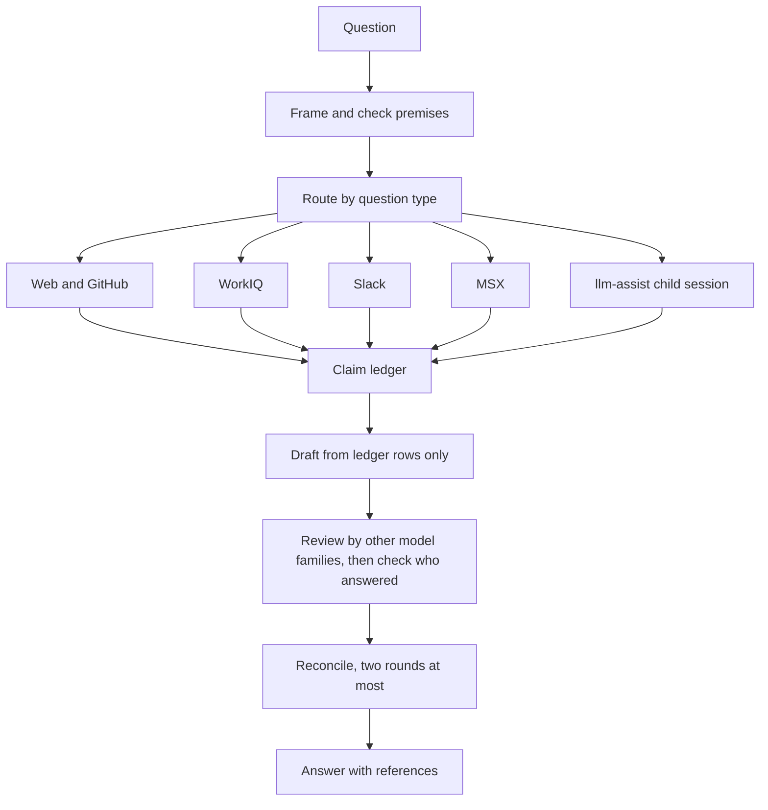

# tech-researcher

A research agent. Ask it a technical question and it returns a short answer with numbered references, after reviewers from other model families have checked the draft. It doesn't edit files, post messages or change records. Its tool list has no write tools for files, Slack or MSX. A tool list can't restrict the shell or subagents, so the read-only rule for those lives in the prompt (see Setup notes).

## Use it

1. Open this repo in the GitHub Copilot desktop app and start a session.
2. Pick `tech-researcher` in the agent picker in the prompt box, or type `/agent`.
3. Ask your question. You can add an audience (internal or external), a depth (standard or deep) and constraints such as a product, version or date range.

Example: "How does Copilot CLI choose between two custom agents that share an id? Audience: external. Depth: deep."

For an external audience the agent cites public sources only. Deep mode adds one blind replication to the review, and it runs on its own when the sources conflict.

The app doesn't hand work to this agent by itself (`infer: false` and `disable-model-invocation: true`), so you pick it.

## How it works



## Sources

| Source | Used for | Access | If unavailable |
|---|---|---|---|
| Web and GitHub | Docs, release notes, source code, issues | `web_search`, `web_fetch`, read-only `gh` through the shell | Reported in Caveats. If nothing can be retrieved, the agent says it couldn't verify the answer. |
| WorkIQ | Internal email, meetings, documents, Teams | `ask_work_iq`, under `workiq/` or `WorkIQ/` | Reported in Caveats. You accept the WorkIQ EULA yourself, the agent never does. |
| Slack | Internal discussion | Six read-only Slack tools, under `GitHub-Slack/` or `slack/` | Reported in Caveats. Sign in under Customize > Installed. |
| MSX | Customer, opportunity and consumption data | Ten read-only `msx-mcp` data tools, plus `msx_auth_status` and `msx_login` | Reported in Caveats. The agent asks before it signs in. |
| llm-assist | Internal knowledge and data explorers | A child session in the llm-assist project | Reported in Caveats. The project must be registered in the app. |

The agent searches public Slack channels by default and asks once per session before it searches private channels and DMs. It flags any private source in Caveats.

Findings from WorkIQ, Slack and llm-assist are leads. The agent opens the underlying source or finds a second one. If it can't, the claim is marked unverified and stays out of categorical statements. For an external audience these findings steer the search but are never cited.

## Review

Before it replies, the agent sends the draft and its claim ledger to reviewers from two other model families. When it can't tell its own family (for example the session runs on Auto), it uses three. It picks the strongest general model in each family from the models the `task` tool offers, and passes each one as an explicit `model`. Each reviewer marks every claim supported, partial, unsupported, contradicted or unverifiable, and has to back an objection with a source.

A model override can fall back to the session's own model without an error. So each reviewer opens its reply by naming its model and family, and the agent compares that with the family it asked for. This is a self-report, a useful check but not proof. If the families don't match, the answer says cross-family review is unconfirmed.

The agent re-checks the source behind each objection before it changes anything. If a claim changes, round 2 runs on fresh `task` calls, because a finished reviewer keeps no memory. It runs two rounds at most and lists what is still disputed in Caveats. If a review can't run, the answer says so.

Deep mode adds one blind replication, a reviewer that sees only the question. It also runs when the sources conflict.

A future option is a dedicated reviewer agent per family with `model-policy: required`, so the platform fails instead of falling back to another model.

## Output

```
**Answer**
The answer, with a reference number after every factual sentence [1].

**Details**
Only when the answer needs steps, a comparison or a command.

**Caveats**
Only when there are any: assumptions, inferences, source conflicts, unreachable sources.

**Verification**
Reviewers requested: <model>, <model>. Self-reported: <family>, <family>. 1 claim changed after review. Unresolved: none. Internal rows were judged against their excerpts only.

**References**
[1] Title. Publisher. https://example.com/page. Version or date; retrieved YYYY-MM-DD. [public]
[2] WorkIQ summary of "<item title>", <date>. No link. Retrieved YYYY-MM-DD. [internal, unverified]
```

Every reference is tagged `[public]` or `[internal]`. Web, GitHub and Slack references use a full URL so you can check them by hand. WorkIQ, MSX and `--help` references have no link, so they name the item, record or command instead.

## Setup notes

- **Server keys.** The `tools` list names the Slack server as `GitHub-Slack` and `slack`, and WorkIQ as `workiq` and `WorkIQ` (a local server and the hosted one use different keys). A name that doesn't resolve is silently ignored. If your MCP config uses another key, find it under Customize > Installed and add that key's tools to the agent file. For Slack that's `slack_search_public`, `slack_search_public_and_private`, `slack_search_channels`, `slack_read_channel`, `slack_read_thread` and `slack_read_canvas`.
- **Missing tools.** A tool allowlist hides everything it doesn't name. If a source you're signed in to still shows as unavailable, check the server key first, then add the specific `server/tool` names. Don't use `*` or `server/*`, which pull in write tools. The validator rejects wildcards.
- **What the tool list can't enforce.** The agent has no `edit` tool, no Slack write tools and no MSX write tools. It does have `execute` (for read-only `gh` and `curl`), `agent` (to launch reviewers) and `create_session` (for the llm-assist child session). The tool list can't restrict what those do, so the prompt does. The validator prints them as write-capable tools so you see them on every run.
- **llm-assist session.** The child session uses a throwaway worktree, so your own checkout stays untouched. It stays in your sidebar after the run so you can see what it did. Archive it when you're done. A worktree holds tracked files only, so if the child needs data that isn't committed, change `workspace_type` to `"branch"` in the agent file.
- **Cost.** A run uses your session model plus two or three reviewers. Deep mode adds one more. Use standard depth for routine questions.

## Test prompts

1. **Known answer.** "Where does Copilot CLI load custom agents from, and which one wins when two share an id?" The answer should match the official docs and cite them.
2. **False premise.** "What does the `--agent-budget` flag of Copilot CLI do?" That flag isn't in the CLI reference as of this writing. The agent should say it found no evidence and name where it looked.
3. **Internal sources.** Ask about a harmless topic you know was discussed in Slack or a meeting. The answer should cite the thread or meeting, tagged `[internal]`.
4. **Review check.** On any question, read the Verification line. It should name the requested models and the families they reported, and the families should differ from the session's own.
