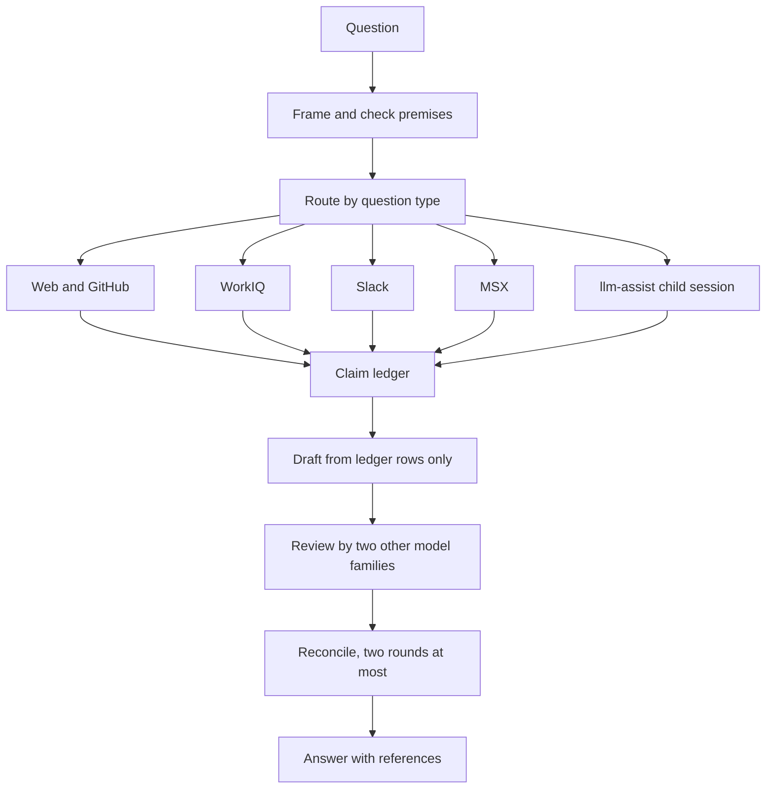

# tech-researcher

A read-only research agent. Ask it a technical question and it returns a short answer with numbered references, after reviewers from other model families have checked the draft. It never writes code and never changes anything.

## Use it

1. Open this repo in the GitHub Copilot desktop app and start a session.
2. Pick `tech-researcher` in the agent picker in the prompt box, or type `/agent`.
3. Ask your question. You can add an audience (internal or external), a depth (standard or deep) and constraints such as a product, version or date range.

Example: "How does Copilot CLI choose between two custom agents that share an id? Audience: external. Depth: deep."

For an external audience the agent cites public sources only. Deep mode adds one blind replication to the review.

## How it works



## Sources

| Source | Used for | Access | If unavailable |
|---|---|---|---|
| Web and GitHub | Docs, release notes, source code, issues | `web_search`, `web_fetch`, read-only `gh` | Reported in Caveats. If nothing can be retrieved, the agent says it couldn't verify the answer. |
| WorkIQ | Internal email, meetings, documents, Teams | `workiq/ask_work_iq` | Reported in Caveats. You accept the WorkIQ EULA yourself, the agent never does. |
| Slack | Internal discussion | Six read-only Slack tools | Reported in Caveats. Sign in under Customize > Installed. |
| MSX | Customer, opportunity and consumption data | Read-only `msx-mcp` tools | Reported in Caveats. The agent asks before it signs in. |
| llm-assist | Internal knowledge and data explorers | A child session in the llm-assist project | Reported in Caveats. The project must be registered in the app. |

The agent searches public Slack channels by default and asks once per session before it searches private channels and DMs. It flags any private source in Caveats.

## Review

Before it replies, the agent sends the draft and its claim ledger to reviewers from two other model families. It picks the strongest non-small model in each family from the models the `task` tool offers. Each reviewer marks every claim supported, partial, unsupported, contradicted or unverifiable, and has to back an objection with a source.

The agent re-checks the source behind each objection before it changes anything, runs two rounds at most, and states in the answer which families reviewed it. If a review can't run, the answer says so.

## Output

```
**Answer**
The answer, with a reference number after every factual sentence [1].

**Details**
Only when the answer needs steps, a comparison or a command.

**Caveats**
Only when there are any: assumptions, inferences, source conflicts, unreachable sources.

**Verification**
Reviewed by GPT and Gemini. 1 claim changed after review. Unresolved: none.

**References**
[1] Title. Publisher. https://example.com/page. Version or date; retrieved YYYY-MM-DD. [public]
```

Every reference is tagged `[public]` or `[internal]` and uses a full URL so you can check it by hand.

## Setup notes

- **Slack server key.** The `tools` list names the Slack server as `GitHub-Slack` or `slack`. If your MCP config uses another key, add that key's six tools to the `tools` list in the agent file: `slack_search_public`, `slack_search_public_and_private`, `slack_search_channels`, `slack_read_channel`, `slack_read_thread` and `slack_read_canvas`.
- **Missing tools.** A tool allowlist hides everything it doesn't name. If a source you're signed in to still shows as unavailable, set `tools: ["*"]` in the agent file. The prompt still keeps the agent read-only, but the allowlist no longer enforces it. The validator warns about wildcards.
- **Cost.** A run uses your session model plus two or three reviewers. Deep mode adds one more. Use standard depth for routine questions.

## Test prompts

1. **Known answer.** "Where does Copilot CLI load custom agents from, and which one wins when two share an id?" The answer should match the official docs and cite them.
2. **False premise.** "What does the `--agent-budget` flag of Copilot CLI do?" That flag isn't in the CLI reference as of this writing. The agent should say it found no evidence and name where it looked.
3. **Internal sources.** Ask about a harmless topic you know was discussed in Slack or a meeting. The answer should cite the thread or meeting, tagged `[internal]`.
